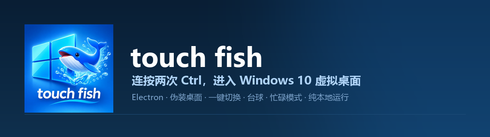
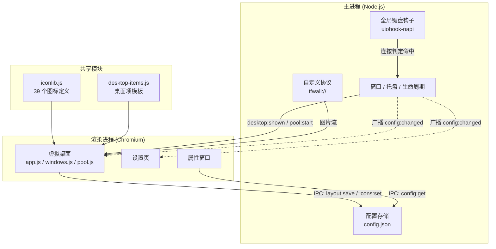

<div align="center">



### 连按两次 `Ctrl`，桌面立刻"变成"一整天在认真工作的样子

一款 Windows 端的**伪装桌面**小工具：全屏覆盖一个高度仿真的 Windows 10 桌面，
图标、任务栏、开始菜单、窗口拖拽缩放一应俱全，再按两次 `Ctrl` 原路返回。

[](#-系统要求)
[](https://www.electronjs.org/)
[](https://github.com/1464530024/touch-fish/releases/latest)
[](https://github.com/1464530024/touch-fish/releases)
[](LICENSE)

**[下载安装包](https://github.com/1464530024/touch-fish/releases/latest)** ·
**[技术文档](docs/TECHNICAL.md)** ·
**[更新日志](CHANGELOG.md)** ·
**[常见问题](#-常见问题)**

</div>

---

## 📸 预览

<div align="center">
  
  <sub>连按两次 Ctrl —— 官方 Hero 壁纸 + 真实系统图标，和真机桌面几乎无差</sub>
</div>

<table>
  <tr>
    <td width="50%"><br /><sub>开始菜单：应用列表 + 磁贴 + 电源区</sub></td>
    <td width="50%"><br /><sub>Win10 风格右键菜单与二级子菜单</sub></td>
  </tr>
  <tr>
    <td><br /><sub>窗口系统：标题栏 / 地址栏 / 任务栏联动</sub></td>
    <td><br /><sub>台球模式：白球、彩球、桌面正中的球洞</sub></td>
  </tr>
  <tr>
    <td><br /><sub>忙碌模式：Word / 剪辑 / PS / 代码四分屏</sub></td>
    <td><br /><sub>右键「属性」→ 内置浏览器（可拖拽缩放）</sub></td>
  </tr>
  <tr>
    <td><br /><sub>自定义壁纸：预览、换图、一键还原</sub></td>
    <td><br /><sub>图标库：主程序与每个桌面图标都能换</sub></td>
  </tr>
</table>

---

## ✨ 它能做什么

| | 能力 | 说明 |
| :--: | --- | --- |
| 🖥️ | **仿真 Win10 桌面** | 官方 Hero 壁纸、真实系统图标、任务栏 / 开始菜单 / 托盘区 / 时钟，全部可交互 |
| ⌨️ | **一键切换** | 默认**连按两次 Ctrl**（间隔 < 420ms）进入，再按两次返回；也可改为连按 Alt / Shift / F9 或 `Ctrl+Shift+Q` 等组合键 |
| 🪟 | **完整窗口系统** | 拖拽、**八向缩放**、最小化、最大化、关闭、层级切换、打开/收起动画、任务栏按钮联动 |
| 🎱 | **台球玩法** | **此电脑 = 白球**，**应用图标 = 彩球**，**球洞在桌面正中**；长按白球出现球杆，向后拖拽蓄力，松开击球 —— 含摩擦减速、球球碰撞、库边反弹、进洞计分 |
| 💼 | **忙碌模式** | 一键铺开 4 个"正在认真工作"的窗口：Word 报告、Premiere 剪辑、Photoshop、VS Code；纯静态渲染，零真实功能、几乎不占资源 |
| 🌐 | **内置浏览器** | 右键**任意图标** →「属性」，在虚拟桌面里弹出浏览器窗口；小说 / 视频站点直接内嵌，Cookie 与托盘收藏共用 |
| ⭐ | **网站收藏** | 设置页填名称 + URL，自动出现在桌面、开始菜单和托盘菜单 |
| 🎨 | **图标伪装** | 39 个图标可选（系统真实图标 + 品牌图标），主程序和每个桌面图标都能换，选中即生效并持久化 |
| 🖼️ | **自定义壁纸** | 支持 JPG / PNG / WebP / BMP，自动复制存档，随时还原官方壁纸 |
| 🐳 | **托盘常驻** | 左键切换桌面；右键菜单含状态提示、网站收藏、一键隐藏、设置、退出 |
| 🙈 | **一键隐藏** | 默认 `Ctrl+Shift+H`，瞬间收起虚拟桌面和所有内嵌窗口 |
| 🔒 | **纯本地** | 所有配置写在 `%APPDATA%\touch fish\config.json`，不联网上传、无账号、无遥测 |

---

## 🚀 安装

### 方式一：安装包（推荐）

前往 **[Releases](https://github.com/1464530024/touch-fish/releases/latest)** 下载 `touch-fish-<version>-setup.exe`，双击安装。

- 免管理员权限，默认装到 `%LOCALAPPDATA%\Programs\touch fish`
- 自动创建桌面与开始菜单快捷方式，并注册到「设置 → 应用」
- 自带卸载程序，安装包约 **77 MB**

> 安装包**未做代码签名**，首次运行 Windows SmartScreen 会提示"未知发布者"，点「更多信息 → 仍要运行」即可。
> 想彻底消除该提示需要购买代码签名证书。

### 方式二：从源码运行

```bash
git clone git@github.com:1464530024/touch-fish.git
cd touch-fish
npm install --registry=https://registry.npmmirror.com
npm start
```

首次运行前建议先执行 `npm run assets`（从你本机的 Windows 提取官方图标与壁纸），详见 [技术文档](docs/TECHNICAL.md#三真实系统资源提取)。

---

## ⌨️ 快捷键

| 操作 | 默认快捷键 | 可自定义 |
| --- | :--: | :--: |
| 进入 / 返回虚拟桌面 | 连按两次 `Ctrl` | ✅ |
| 一键隐藏全部窗口 | `Ctrl + Shift + H` | ✅ |
| 退出程序 | 托盘右键 → 退出 | — |

连击间隔阈值、组合键模式都能在「设置 → 快捷键」里改，保存后立即生效。

---

## 🧱 技术栈

| 层 | 选型 | 用途 |
| --- | --- | --- |
| 运行时 | **Electron 33** | 主进程 / 预加载 / 渲染进程三层架构 |
| 全局热键 | **uiohook-napi**（libuiohook） | 低级键盘钩子，捕获**裸修饰键连按**；失败时降级到 `globalShortcut` |
| 打包 | **electron-builder + NSIS** | 生成带卸载程序的安装包 |
| 图标提取 | **Python ctypes + COM** | `IShellItemImageFactory` 取系统真实图标 |
| 内嵌网页 | **Electron `<webview>`** | 持久化 session 分区，登录态与托盘收藏互通 |
| 物理 | **Canvas 2D 手写** | 圆-圆弹性碰撞、指数摩擦、子步进防穿透 |



更完整的设计说明、IPC 协议表、配置结构与踩坑记录见 **[docs/TECHNICAL.md](docs/TECHNICAL.md)**。

---

## 📁 项目结构

```
touch-fish/
├─ src/
│  ├─ main/                     # 主进程
│  │  ├─ main.js                #   窗口 / 托盘 / 快捷键 / IPC / 壁纸协议 / 卸载入口
│  │  ├─ store.js               #   配置读写（深合并默认值 + 原子写）
│  │  └─ hotkey.js              #   全局键盘钩子与连按判定
│  ├─ preload/                  # 预加载桥（contextBridge 暴露 window.TF）
│  │  ├─ desktop.js / settings.js / property.js
│  ├─ shared/                   # 主进程与渲染进程共用
│  │  ├─ iconlib.js             #   39 个图标定义
│  │  └─ desktop-items.js       #   桌面项与默认收藏
│  └─ renderer/                 # 界面
│     ├─ desktop/               #   虚拟桌面：app.js / windows.js / pool.js / desktop.css
│     ├─ settings/              #   设置页
│     └─ property/              #   独立属性窗口（旧实现，保留兼容）
├─ tools/
│  ├─ extract-icons.py          # 从系统提取真实图标（IShellItemImageFactory + imageres.dll）
│  ├─ render-icons.js           # SVG → PNG 栅格化
│  ├─ make-ico.js               # 生成多尺寸 icon.ico
│  ├─ run.py                    # 开发启动器（剥离 ELECTRON_RUN_AS_NODE）
│  ├─ e2e-test.py               # 端到端自测：注入双击 Ctrl + 全屏截图
│  └─ measure-desktop.py        # 用 Chromium 量桌面网格几何尺寸
├─ assets/                      # 壁纸 / 图标 / 托盘 / logo
├─ build/                       # 打包图标（icon.ico 多尺寸）
├─ docs/
│  ├─ TECHNICAL.md              # 技术说明文档（架构 / 算法 / IPC / 踩坑全记录）
│  ├─ RELEASE-NOTES-v1.1.0.md   # 本版发布说明
│  └─ images/                   # README 截图（1600px，压缩后约 1.1 MB）
└─ dist/                        # 打包输出（不入库）
```

---

## 🔨 构建

```bash
# 生成图标（首次需要，依赖 Python + Pillow）
npm run assets

# 打包安装包
npm run build
# → dist/touch-fish-1.1.0-setup.exe
```

国内网络环境打包常踩的三个坑（镜像、`NODE_OPTIONS`、winCodeSign 符号链接）已在
[技术文档 · 打包](docs/TECHNICAL.md#七打包与踩坑记录) 里给出完整解法。

---

## 🗑️ 卸载

1. **设置 → 应用 → 已安装的应用 → touch fish → 卸载**（推荐）
2. 设置页「关于与卸载」→ 点「卸载 touch fish」
3. 手动：删除安装目录 + 快捷方式；彻底清理再删 `%APPDATA%\touch fish`

> 卸载默认保留个人配置（收藏、图标伪装）。想彻底清空请手动删除配置目录。

---

## ❓ 常见问题

<details>
<summary><b>连按两次 Ctrl 没反应？</b></summary>

部分安全软件会拦截低级键盘钩子。打开「设置 → 快捷键」改用组合键（如 `Ctrl+Shift+Q`），程序会自动降级到 `globalShortcut`，不依赖钩子。
</details>

<details>
<summary><b>虚拟桌面盖不住任务栏？</b></summary>

程序以全屏置顶方式覆盖**主显示器**；多屏环境下副屏保持原样（更接近真实场景）。请在主屏操作。
</details>

<details>
<summary><b>内嵌网站提示"不允许被内嵌"？</b></summary>

少数站点通过 `X-Frame-Options` / CSP 拒绝被嵌入。点工具栏右侧「浏览器打开」用系统浏览器访问即可。
</details>

<details>
<summary><b>台球怎么玩？</b></summary>

进入台球模式 → 长按【此电脑】白球 → 向后拖拽蓄力 → 松开击球。彩球每次随机散落，黑色球洞固定在桌面正中，进洞计分，白球落袋自动归位。点「重新开局」重新随机摆球。
</details>

<details>
<summary><b>忙碌模式关掉一个窗口，为什么它下次还在？</b></summary>

忙碌模式是整体开关，关单个窗口不算退出。要「收工」请再点一次「忙碌模式」。
</details>

<details>
<summary><b>自定义壁纸存在哪？</b></summary>

选择后复制一份到 `%APPDATA%\touch fish\wallpaper.<ext>`，原图不受影响；点「恢复 Windows 10 默认」会删除副本并切回官方壁纸。
</details>

<details>
<summary><b>被 Windows Defender 报毒 / SmartScreen 拦截？</b></summary>

安装包未签名，且全局键盘钩子是杀软重点关注对象。添加信任即可；介意的话请自行从源码构建。
</details>

---

## 📋 系统要求

- Windows 10 / 11（x64）
- 安装包版本：无需额外依赖
- 源码运行：Node.js ≥ 18、npm；提取真实图标需要 Python 3.8+ 与 Pillow

---

## ⚠️ 免责声明与版权

- 本项目为**个人效率工具**，用于给自己的桌面做视觉隔离与短暂休息。请遵守所在单位的设备与考勤管理规定，**不要用于任何形式的欺骗、考勤造假或其他不当用途**。
- 桌面图标与壁纸提取自**本机 Windows 系统资源**（`imageres.dll`、`C:\Windows\Web\Wallpaper`），版权归 **Microsoft Corporation** 所有，此处仅作技术演示与个人本地使用，**不随 MIT 协议授权**。如你是权利方并认为不妥，请提 issue，会立即移除。
- 代码部分采用 MIT 协议，详见 [LICENSE](LICENSE)。

---

## 📄 License

[MIT](LICENSE) © 2026 touch fish contributors

<div align="center">
<sub>如果这个项目让你在工位上多喘了口气，欢迎点个 ⭐</sub>
</div>
