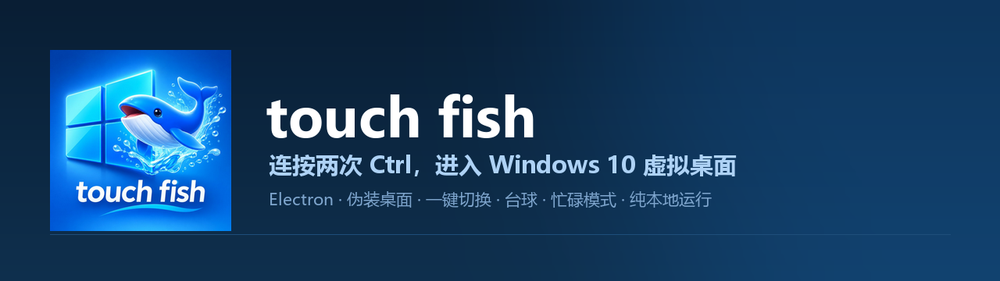

<div align="center">



**v1.1.0 · 2026-11-17**

</div>

---

## 📦 下载

| 文件 | 说明 | 大小 |
| --- | --- | :--: |
| **`touch-fish-1.1.0-setup.exe`** | Windows 10 / 11 (x64) 安装包，免管理员权限 | 73.6 MB |

**安装**：双击 → 选择安装目录（默认 `%LOCALAPPDATA%\Programs\touch fish`）→ 完成。
程序会自动创建桌面与开始菜单快捷方式，并注册到「设置 → 应用」。

> ⚠️ 安装包**未做代码签名**，首次运行 SmartScreen 会提示"Windows 已保护你的电脑"，
> 点「更多信息 → 仍要运行」即可。想彻底消除需要购买代码签名证书。

**校验**（可选）：

```
SHA256  d864f1681fd4694320e6aaf500841c3d03f099e8284605ce12f3e1726a577663
```

---

## 🆕 本版更新

### 新增：忙碌模式

一键在虚拟桌面上铺开 4 个"正在认真工作"的窗口，四分屏各占一角：

| 窗口 | 仿真内容 |
| --- | --- |
| **Word** | 功能区（粘贴 / 字体 / 段落 / 样式）+ 中文经营分析报告 + 数据表格 + `160%` 缩放状态栏 |
| **Premiere** | 项目面板、素材树、监视器、四轨时间线（含音频轨）、效果控件、示波器 |
| **Photoshop** | 工具栏、棋盘格画布上的主视觉、图层列表、色带 |
| **VS Code** | 活动栏、资源树、语法高亮代码、终端日志、蓝色状态栏 |

纯 CSS 静态渲染，**零真实功能、零外部依赖、几乎不占资源**。
入口有四处：桌面右键 / 右下角鲸鱼菜单 / 开始菜单磁贴 / 设置页开关。

### 新增：自定义壁纸

设置 → 个性化 → 选择图片。支持 JPG / PNG / WebP / BMP / GIF，
带实时预览与「恢复 Windows 10 默认」。

### 新增：桌面内置浏览器

右键**任意**图标 →「属性」，直接在虚拟桌面里弹出浏览器窗口：

- 前进 / 后退 / 刷新 / 地址栏 / 在系统浏览器中打开
- 站点图标打开自己的网址，普通图标打开第一个收藏（默认起点中文网）
- 可鼠标拖拽缩放（最小 520×340），Cookie 与托盘收藏共用登录态

---

## 🔧 修复

| 问题 | 原因 | 处理 |
| --- | --- | --- |
| **右键菜单卡住**：点了空白处，二级子菜单还挂在屏幕上 | 子菜单复用了主菜单的 `id="ctxMenu"`，存在两条关闭路径，点主菜单叶子项时只关了主菜单 | 子菜单改独立 class，收敛为唯一 `closeMenus()` 出口；关闭动作移到 `mousedown` 捕获阶段；加 `window.blur` 兜底 |
| **「属性」窗口一按 Alt+Tab 就露馅** | v1.0 弹的是独立 `BrowserWindow`，会进入真实任务栏 | 改为虚拟桌面内的窗口，与桌面同生共死 |
| **台球布局呆板** | 按桌面图标原位摆球，永远一个样 | 拒绝采样随机布球（避开球洞 / HUD / 力度条，球间距 ≥ 2R+12），**球洞固定在桌面正中**，配色每局打乱 |
| **`Google Chrome` 被断成 `Chrom` / `e`** | 标签用了 `word-break: break-all` | 改为 `overflow-wrap: anywhere`，按词断行 |
| **「文件资源管理器」标签第三行被裁** | 名称过长 | 更名「资源管理器」 |
| **设置页切页后不重绘** | 窗口被判定遮挡，合成器停止出帧 | 关闭该窗口的 `backgroundThrottling` |

---

## ✨ 其它改进

- 窗口缩放从「右下角单把手」升级为**八向把手**
- 桌面图标网格对齐真机 Win10（单元格 84×96、图标 48px、标签 12px 两行）
- 安装包瘦身 83 MB → **73.6 MB**（只保留 `zh-CN` / `en-US` 语言包与 `win32-x64` 原生模块）
- 自检新增 `[menu-check]` / `[prop-check]` / `[web-info]` / `[resize-check]` 结构化断言

---

## 🖥 系统要求

- Windows 10 / 11，x64
- 无需 Node.js、无需管理员权限

---

## ⌨️ 默认快捷键

| 操作 | 快捷键 |
| --- | --- |
| 进入 / 返回虚拟桌面 | 连按两次 `Ctrl`（间隔 < 420ms） |
| 一键隐藏全部窗口 | `Ctrl + Shift + H` |
| 退出程序 | 托盘右键 → 退出 touch fish |

三项均可在「设置 → 快捷键」中修改，保存即生效。

---

## 🗑 卸载

**设置 → 应用 → 已安装的应用 → touch fish → 卸载**，
或运行安装目录下的 `Uninstall touch fish.exe`。

卸载会保留个人配置（`%APPDATA%\touch fish`），想彻底清空请手动删除该目录。

---

## 📄 说明

- 本工具为**个人效率工具**，用于给自己的桌面做视觉隔离与短暂休息。请遵守所在单位的设备与考勤管理规定。
- 桌面图标与壁纸提取自本机 Windows 系统资源，版权归 Microsoft Corporation 所有，不随 MIT 协议授权。
- 代码部分采用 [MIT 协议](https://github.com/1464530024/touch-fish/blob/main/LICENSE)。

**完整变更**：见 [CHANGELOG.md](https://github.com/1464530024/touch-fish/blob/main/CHANGELOG.md) ·
**技术文档**：见 [docs/TECHNICAL.md](https://github.com/1464530024/touch-fish/blob/main/docs/TECHNICAL.md)
